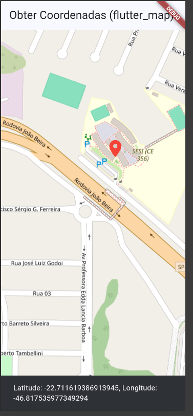

# 🏍️ Aplicativo de Rotas

Aplicativo desenvolvido em Flutter seguindo a proposta da atividade. O projeto utiliza o pacote `flutter_map` para apresentar um mapa interativo, permitindo selecionar pontos e visualizar suas respectivas coordenadas.

# 🎯 Objetivo

O aplicativo disponibiliza um mapa interativo onde o usuário pode selecionar um local para consultar sua posição.

Ao selecionar um ponto no mapa, são apresentados:

- Latitude
- Longitude
- Marcador indicando o local escolhido

# Aplicativo funcionando

# Tecnologias utilizadas
- Flutter
- Dart
- Visual Studio Code
- Mapa
- GitHub
- flutter_map
- OpenStreetMap
- latlong2
- Android Studio

# Como executar
Antes de iniciar o projeto, é necessário possuir instalado:

- Flutter
- Dart
- Visual Studio Code
- Android Studio

## Clone o repositório
git clone https://github.com/CarlosHAlb/flutter_map

## Entre na pasta
- cd flutter_masp_nativo

## Instale as Dependência
- flutter pub get

## Execute o Aplicativo
- flutter run

# Teste o mapa
- Aguarde o mapa ser carregado.
- Selecione qualquer local no mapa.
- Um marcador será adicionado ao ponto escolhido.
- A latitude e a longitude do local serão mostradas na tela.